# Software Requirements Specification & Design Description (SRDS)

## MindEase: AI-Driven Stress Detection, Recovery & Support for Students

**COMSATS University Islamabad, Wah Campus**  
**Department of Computer Science**  
**Project Stream:** Mobile Apps Final Year Project (FYP)  
**Session:** FA23 — Fall 2026  

### Project Members:
1. **Muhammad Rehan Khalid** (CIIT/FA23-BCS-140/WAH)
2. **Umayya Wahid** (CIIT/FA23-BCS-172/WAH)

**Supervised By:** Ma'am Seema Islam

---

## Table of Contents
- 1 INTRODUCTION
- 1.1 System Introduction
- 1.2 Background of the System
- 1.3 Objectives of the System
- 1.4 Significance of the System
- 2 OVERALL DESCRIPTION
- 2.1 Product Perspective
- 2.2 Product Scope
- 2.3 Product Functionality
- 2.4 Users and Characteristics
- 2.5 Operating Environment
- 3 SPECIFIC REQUIREMENTS
- 3.1 Functional Requirements
- 3.2 Behaviour Requirements
- 3.3 External Interface Requirements
- 4 OTHER NON-FUNCTIONAL REQUIREMENTS
- 4.1 Performance Requirements
- 4.2 Safety and Security Requirements
- 4.3 Software Quality Attributes
- 5 DESIGN DESCRIPTION
- 5.1 Composite Viewpoint
- 5.2 Logical Viewpoint
- 5.3 Information Viewpoint
- 5.4 Interaction Viewpoint (Traceability & Sequence Diagrams)
- 5.5 State Dynamics Viewpoint
- 5.6 Algorithm Viewpoint

---

# 1 Introduction

## 1.1 System Introduction
MindEase is an AI-driven, comprehensive mobile mental health and academic stress management application designed specifically for university students in Pakistan. Undergraduates frequently encounter severe stress stemming from exams, deadlines, sleep deficits, and personal challenges. MindEase provides early detection, human-understandable Explainable AI (XAI) insights, personalized recovery content, adaptive study scheduling, conversational AI support, and direct access to university counselors.

## 1.2 Background of the System
Commercial wellness tools (Calm, Headspace, Wysa) fail to accommodate the regional linguistic reality of Pakistani students (Urdu, Roman Urdu) and treat mindfulness in total isolation from academic schedules. MindEase bridges these critical gaps through multilingual Whisper speech transcription, multimodal feature fusion, SHAP attribution, and integrated counselor appointments with guaranteed free triage.

## 1.3 Objectives of the System
### General Objective
To develop MindEase, an AI-based mobile app helping students understand, detect, and actively manage stress with explainable root causes, progress tracking, relaxation activities, adaptive study planning, and counselor access.

### Specific Objectives
- To allow university students to answer standardized stress questionnaires in English, Urdu, or Roman Urdu.
- To employ AI natural language processing to interpret students' free-form written and voice reflections.
- To estimate stress levels accurately into Low, Moderate, or High categories based on confirmed scores and behavioral data.
- To provide Explainable AI (XAI) insights that elucidate the principal factors driving the student's stress in clear, non-technical words.
- To transcribe and analyze daily voice and text check-ins using Whisper ASR, extracting sentiments, emotional tone, and core topics.
- To capture and correlate daily habit metrics including sleep duration, smartphone screen time, and daily physical step counts.
- To record longitudinal stress trends and display weekly and monthly progress trajectories through intuitive graphical charts.
- To curate an adaptive content library offering calming music, uplifting stories, relaxation videos, breathing exercises, and recitations.
- To formulate adaptive daily study plans that automatically compress session lengths and interleave restorative breaks when high stress is detected.
- To provide an AI conversational chatbot for real-time empathetic companionship, self-help guidance, and professional escalation.
- To establish a verified Counselor Portal allowing students to review counselor profiles and book appointments, guaranteeing one free session following High stress detection.
- To provide an Admin Portal for content moderation, counselor verification, and system telemetry management while strictly protecting private student diaries.
- To ensure end-to-end data security, Row-Level Security (RLS), and database persistence using Supabase (PostgreSQL) and Polar payment test integration.

## 1.4 Significance of the System
MindEase delivers early stress intervention, destigmatizes mental healthcare through privacy-first digital engagement, bridges language barriers via Urdu/Roman Urdu NLP, and connects students seamlessly to university counselors.

# 2 Overall Description

## 2.1 Product Perspective
MindEase operates across a multi-tier client-server architecture: Flutter Mobile Client, FastAPI Backend Application Server, ML Inference Micro-services (Whisper ASR, Multimodal PyTorch classifier, SHAP explainer), Supabase Cloud PostgreSQL, and Polar Payment Gateway.

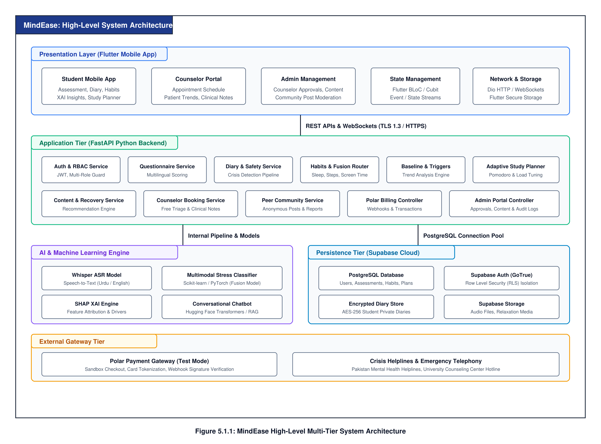

## 2.2 Product Scope
- **In Scope:** Multilingual questionnaire, voice/text daily diary with safety crisis checks, habit tracking, multimodal stress classification (Low/Moderate/High), SHAP XAI factor attribution, adaptive study planning, relaxation content library, AI chatbot, counselor booking with free triage, Polar billing, and community support.
- **Out of Scope (Medical Disclaimer):** MindEase is not a certified diagnostic device and does not issue medical diagnoses or prescribe psychiatric medication.

## 2.3 Product Functionality
### Module 1: Multilingual Stress Questionnaire and Scoring
Enables students to complete stress assessments in English, Urdu, or Roman Urdu with AI scoring assistance for written text and manual score confirmation.

### Module 2: Voice and Text Check-in (Daily Diary)
Captures audio and text reflections, transcribes audio using Whisper ASR, extracts emotional sentiment, and scans for danger/crisis indicators.

### Module 3: Habit Tracking and Stress Level Detection
Gathers sleep duration, screen time, and daily steps, fusing habit metrics with psychological scores to classify overall stress into Low, Moderate, or High.

### Module 4: Personal Baseline and Trigger Analysis
Calculates a dynamic rolling baseline over longitudinal check-ins, identifying trend trajectories (improving, stable, escalating) and academic correlations.

### Module 5: Explainable AI (XAI) and Insights
Deploys SHAP game-theoretic feature attribution to show students the exact behavioral factors responsible for their stress rating.

### Module 6: Recommendations and Content Library
Curates calming media (music, videos, stories, recitations) and measures delta stress relief via pre- and post-activity rating scales.

### Module 7: AI Chatbot and Conversational Support
Delivers 24/7 conversational assistance, contextualized with recent stress history upon student consent, offering empathetic companionship and triage recommendations.

### Module 8: Adaptive Study and Recovery Planner
Generates daily task schedules that adapt block lengths and break frequencies according to the student's real-time stress state.

### Module 9: Counselor Portal and Professional Support
Enables verified counselors to manage availability, conduct sessions, review consented student stress histories, and archive encrypted clinical notes.

### Module 10: Admin Portal and Content Management
Empowers university administrators to manage user accounts, approve counselor licenses, curate the content library, and resolve moderation reports without accessing private diaries.

### Module 11: Community Support
Provides a peer interaction platform featuring anonymous posts, verified counselor badges, and community report safety mechanisms.

### Module 12: Payments and Appointment Billing (Polar)
Manages appointment financial transactions using Polar's test mode sandbox, enforcing the free-tier triage rule and verifying payments via HMAC webhooks.

## 2.4 Users and Characteristics
- **Student (Primary User):** High frequency (daily to multiple times per week). Moderate technical expertise. Primary goal: track wellness, understand stress causes, plan study tasks, and access confidential help without social stigma.
- **Counselor (Mental Health Professional):** Moderate frequency (scheduled weekly/daily appointment slots). High professional clinical expertise, moderate technical expertise. Primary goal: review consented student histories, conduct therapy sessions, and record clinical observations.
- **Administrator (System Admin):** Regular administrative frequency. High technical expertise, privileged system access. Primary goal: review counselor applications, moderate flagged community posts, maintain media libraries, and inspect platform telemetry.

## 2.5 Operating Environment
Android 9.0+ smartphones (2 GB RAM min), Ubuntu Linux 22.04 LTS cloud server, Python 3.11+, FastAPI, Supabase PostgreSQL 15, and Polar sandbox.

# 3 Specific Requirements

## 3.1 Functional Requirements
### 3.1.1 User Authentication & Role Management
- **[FR-01]** The system shall permit students and counselors to register accounts using their institutional or personal email addresses.
- **[FR-02]** The system shall enforce email verification before activating new user accounts.
- **[FR-03]** The system shall support multi-role authentication (Student, Counselor, Admin) using Supabase Auth JWT tokens.
- **[FR-04]** The system shall require counselor applicants to upload licensing credentials, retaining their status as 'Pending' until admin approval.
- **[FR-05]** The system shall provide secure password reset functionality via time-limited cryptographic email tokens.
- **[FR-06]** The system shall enforce Row-Level Security (RLS) policies at the database layer to prevent unauthorized cross-tenant data access.

### 3.1.2 Multilingual Stress Questionnaire & Scoring
- **[FR-07]** The system shall provide standardized stress assessment questionnaires localized in English, Urdu, and Roman Urdu.
- **[FR-08]** The system shall support both multiple-choice selection and free-form text input for questionnaire questions.
- **[FR-09]** The system shall employ an NLP text evaluator to suggest numerical scores for open-ended written responses.
- **[FR-10]** The system shall require students to review and confirm or adjust any AI-suggested score before final tabulation.
- **[FR-11]** The system shall compute the cumulative Perceived Stress Scale (PSS) questionnaire score.
- **[FR-12]** The system shall persist confirmed questionnaire assessments with timestamps in the PostgreSQL database.

### 3.1.3 Voice & Text Daily Diary Check-in
- **[FR-13]** The system shall allow students to record audio reflections up to 3 minutes in duration in English, Urdu, or Roman Urdu.
- **[FR-14]** The system shall allow students to submit text diary entries in supported languages.
- **[FR-15]** The system shall transcribe voice audio into text using the Whisper ASR deep learning model.
- **[FR-16]** The system shall extract sentiment polarity, emotional valence, and primary topic tags (academics, sleep, relationships) from diary text.
- **[FR-17]** The system shall assign a normalized diary stress score based on NLP sentiment analysis.
- **[FR-18]** The system shall automatically scan diary text for danger or self-harm keywords, instantly triggering crisis helpline resources if flagged.
- **[FR-19]** The system shall encrypt diary contents using AES-256 before persisting records to ensure absolute privacy.

### 3.1.4 Habit Tracking & Multimodal Stress Fusion
- **[FR-20]** The system shall provide an intuitive interface for students to log daily sleep hours, smartphone screen time, and step counts.
- **[FR-21]** The system shall permit students to skip any optional habit metric without blocking assessment completion.
- **[FR-22]** The system shall impute missing habit values using the student's rolling 7-day personal average.
- **[FR-23]** The system shall combine questionnaire scores, diary sentiment, and habit metrics into a unified feature vector.
- **[FR-24]** The multimodal ML fusion model shall classify the student's stress level into Low, Moderate, or High categories along with a confidence metric.
- **[FR-25]** The system shall store the daily stress classification and feature snapshot in the database.

### 3.1.5 Personal Baseline & Trigger Analysis
- **[FR-26]** The system shall establish a baseline stress profile after a student completes three initial check-ins.
- **[FR-27]** The system shall continuously calculate a rolling 14-day baseline to accommodate natural stress fluctuations.
- **[FR-28]** The system shall classify stress trend trajectories as Improving, Stable, or Escalating.
- **[FR-29]** The system shall correlate stress spikes with user-inputted university academic events (exams, project submissions).
- **[FR-30]** The system shall generate interactive weekly and monthly graphical charts showing stress progress over time.

### 3.1.6 Explainable AI (XAI) & Insights
- **[FR-31]** The system shall compute SHAP (SHapley Additive exPlanations) values for each daily multimodal stress assessment.
- **[FR-32]** The system shall rank the top three contributing factors driving the estimated stress level.
- **[FR-33]** The system shall translate mathematical SHAP attributions into clear, human-understandable English/Urdu explanations.
- **[FR-34]** The system shall render an intuitive feature importance bar chart illustrating positive and negative stress drivers.
- **[FR-35]** The system shall map identified primary stress drivers to targeted, actionable recovery recommendations.

### 3.1.7 Recommendations & Relaxation Content Library
- **[FR-36]** The system shall filter and recommend calming content based on the student's real-time stress level and identified drivers.
- **[FR-37]** The content library shall support ambient music, uplifting stories, guided breathing exercises, and spiritual recitations.
- **[FR-38]** The system shall allow students to bookmark favourite media resources into a personalized 'My Collection' list.
- **[FR-39]** The system shall prompt students to record self-reported stress ratings (1-10) before and after completing a relaxation activity.
- **[FR-40]** The system shall track delta stress reduction to calculate and display individualized content effectiveness scores.

### 3.1.8 AI Chatbot & Conversational Support
- **[FR-41]** The system shall provide an interactive conversational AI interface supporting text and voice messaging.
- **[FR-42]** The system shall support conversational interactions in English, Urdu, and Roman Urdu.
- **[FR-43]** With explicit student permission, the chatbot shall ingest recent stress levels to tailor its supportive dialogue.
- **[FR-44]** The chatbot shall provide cognitive reframing suggestions, breathing exercises, and motivational guidance.
- **[FR-45]** The chatbot shall detect clinical distress and proactively suggest scheduling a session with a campus counselor.
- **[FR-46]** The system shall maintain encrypted conversation history accessible only to the authenticated student.

### 3.1.9 Adaptive Study & Recovery Planner
- **[FR-47]** The system shall allow students to create academic tasks, assign deadlines, and specify subject weights.
- **[FR-48]** The system shall generate daily study schedules divided into structured Pomodoro focus sessions and breaks.
- **[FR-49]** When High stress is detected, the planner shall automatically compress session durations (e.g., to 25 mins) and expand rest periods.
- **[FR-50]** The planner shall schedule mindfulness and relaxation exercises during extended break periods.
- **[FR-51]** The system shall allow students to reschedule or roll over uncompleted study tasks to the subsequent day.
- **[FR-52]** The system shall track study task completion rates and display academic productivity statistics.

### 3.1.10 Counselor Portal & Professional Support
- **[FR-53]** The system shall publish verified counselor profiles displaying qualifications, specializations, languages, and open time slots.
- **[FR-54]** The system shall allow students to request virtual counseling appointments.
- **[FR-55]** The system shall provide the first counseling appointment completely free of charge when triggered by a High stress assessment.
- **[FR-56]** The system shall require payment verification for subsequent counseling appointments according to institutional policy.
- **[FR-57]** With student consent, counselors shall be authorized to inspect historical stress trends, baselines, and XAI insights.
- **[FR-58]** The system shall provide an encrypted clinical notes editor for counselors to record post-session evaluations.

### 3.1.11 Peer Community Support & Moderation
- **[FR-59]** The system shall allow students to publish text posts, share personal coping experiences, and comment on peer posts.
- **[FR-60]** The system shall allow students to publish community posts under an anonymous pseudonym.
- **[FR-61]** The system shall highlight comments posted by verified counselors with a distinct, tamper-proof 'Counselor Badge'.
- **[FR-62]** The system shall execute automated keyword filtering to block profane, abusive, or explicitly harmful content.
- **[FR-63]** The system shall provide a 'Flag / Report' mechanism allowing users to report inappropriate community contributions.
- **[FR-64]** The system shall temporarily quarantine community posts that exceed a predefined flag threshold pending admin review.

### 3.1.12 Polar Payment Gateway & Billing Service
- **[FR-65]** The system shall integrate with the Polar payment platform operating in test/sandbox mode.
- **[FR-66]** The system shall generate secure checkout sessions for paid counseling appointments.
- **[FR-67]** The system shall process webhook events dispatched by Polar to verify successful transactions.
- **[FR-68]** The system shall verify HMAC-SHA256 signatures on all incoming Polar webhooks before confirming bookings.
- **[FR-69]** The system shall display digital payment receipts with transaction reference numbers to students.
- **[FR-70]** The system shall never store raw credit card numbers or CVV codes, ensuring strict PCI-DSS compliance.

### 3.1.13 Admin Portal & Content Management
- **[FR-71]** The system shall provide an administrative console accessible exclusively to authorized university admins.
- **[FR-72]** The system shall allow admins to inspect pending counselor registration requests and approve or reject licenses.
- **[FR-73]** The system shall allow admins to upload, edit, categorize, and archive content library media resources.
- **[FR-74]** The system shall display reported community posts in an actionable moderation queue for deletion or dismissal.
- **[FR-75]** The system shall display anonymized campus-wide stress trends and platform engagement analytics.
- **[FR-76]** The system shall strictly block administrative access to student private diaries, voice recordings, and chatbot logs.

## 3.2 Behaviour Requirements

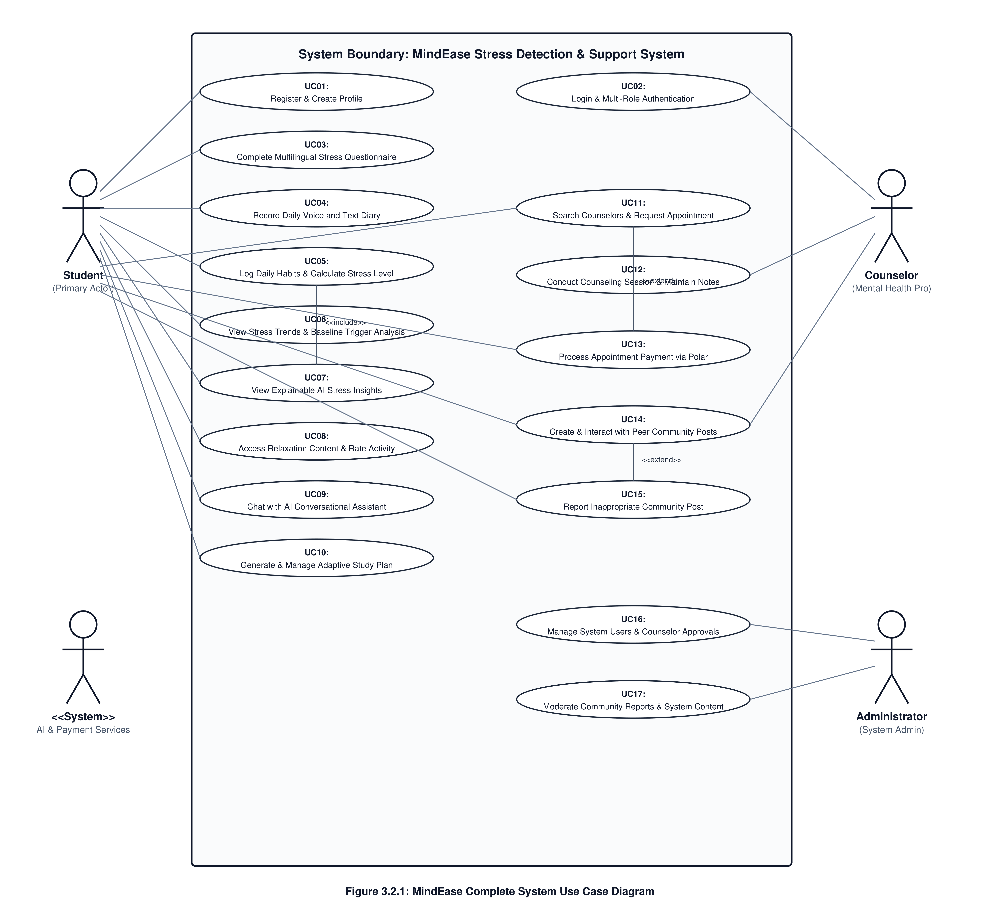

### System Use Case Inventory
| Use Case ID | Use Case Name | Actors | Scope Summary |
|:---:|:---|:---|:---|
| **UC01** | Register & Create Profile | Student, Counselor | Account creation and profile registration. |
| **UC02** | Login & Multi-Role Authentication | Student, Counselor, Admin | Credentials verification and role-based routing. |
| **UC03** | Complete Multilingual Stress Questionnaire | Student | PSS assessment in English/Urdu/Roman Urdu with text scoring. |
| **UC04** | Record Daily Voice and Text Diary | Student | Audio recording, Whisper ASR STT, sentiment analysis, crisis check. |
| **UC05** | Log Daily Habits & Calculate Stress Level | Student | Habit data entry and multimodal ML stress classification. |
| **UC06** | View Stress Trends & Baseline Trigger Analysis | Student | Longitudinal progress graphs and exam trigger correlation. |
| **UC07** | View Explainable AI Stress Insights | Student | SHAP feature attribution charts and actionable recommendations. |
| **UC08** | Access Relaxation Content & Rate Activity | Student | Browsing calming media and pre/post activity rating. |
| **UC09** | Chat with AI Conversational Assistant | Student | Contextual empathetic support and escalation suggestions. |
| **UC10** | Generate & Manage Adaptive Study Plan | Student | Task chunking and stress-adaptive Pomodoro scheduling. |
| **UC11** | Search Counselors & Request Appointment | Student | Directory filtering, free triage check, and appointment request. |
| **UC12** | Conduct Counseling Session & Maintain Notes | Counselor | Virtual session execution, trend review, encrypted clinical notes. |
| **UC13** | Process Appointment Payment via Polar | Student | Test mode checkout, payment capture, webhook confirmation. |
| **UC14** | Create & Interact with Peer Community Posts | Student, Counselor | Sharing peer messages, anonymous posting, counselor badges. |
| **UC15** | Report Inappropriate Community Post | Student | Flagging abusive content and automated quarantine. |
| **UC16** | Manage System Users & Counselor Approvals | Administrator | Reviewing credentials, granting counselor permissions. |
| **UC17** | Moderate Community Reports & System Content | Administrator | Triage reported posts queue and curate relaxation media. |

### Fully Dressed Use Cases

#### Use Case #1: Register & Create Profile

| Field | Details |
|---|---|
| **Primary Actors** | Student, Counselor |
| **Secondary Actors** | Supabase Auth, ProfileRepository |
| **Description** | A new student or counselor registers an account in MindEase by providing personal credentials, institutional details, and role specifications. |
| **Pre-Condition** | The user must have a valid institutional or personal email address and not already possess an active registered account. |
| **Steps** | 1. The user launches the MindEase application and selects 'Register'. 2. The user inputs their full name, email, password, and selects their role (Student or Counselor). 3. If Counselor is selected, the user enters license number, specialization, and uploads credential documentation. 4. The system validates the input fields for format correctness and checks for duplicate registrations. 5. The system creates the user record in Supabase Auth and stores profile details in the database. 6. For students, the account is marked active upon email confirmation; for counselors, status remains 'Pending' awaiting admin review. |
| **Post-Condition** | A new user account is successfully provisioned and an activation confirmation message is displayed. |
| **Exceptions** | If the email is already registered or passwords do not satisfy complexity requirements, the system displays an error and denies submission. |
| **Relationships** | Extended by Manage System Users & Counselor Approvals (UC16) for counselor credential validation. |

#### Use Case #2: Login & Multi-Role Authentication

| Field | Details |
|---|---|
| **Primary Actors** | Student, Counselor, Administrator |
| **Secondary Actors** | Supabase Auth (GoTrue) |
| **Description** | Registered users authenticate with their email and password to receive secure JWT tokens and be routed to their respective role dashboards. |
| **Pre-Condition** | The user must possess a registered and verified account. |
| **Steps** | 1. The user opens the MindEase login screen. 2. The user enters their registered email address and password. 3. The system verifies credentials against Supabase Auth. 4. The system inspects the user's assigned role (Student, Counselor, or Admin). 5. The system issues a session token and redirects the user to their designated dashboard (Student Home, Counselor Portal, or Admin Console). |
| **Post-Condition** | The user is authenticated and authorized to access features corresponding to their privilege level. |
| **Exceptions** | If credentials are invalid or if a counselor account is still 'Pending', the system displays an error and blocks portal entry. |
| **Relationships** | Foundational use case prerequisite for all core interactive features. |

#### Use Case #3: Complete Multilingual Stress Questionnaire

| Field | Details |
|---|---|
| **Primary Actors** | Student |
| **Secondary Actors** | ScoringEngine, StressRepository |
| **Description** | A student completes a standardized psychological stress questionnaire in their preferred language (English, Urdu, or Roman Urdu), confirming AI suggestions for open-ended text. |
| **Pre-Condition** | The student must be logged in. |
| **Steps** | 1. The student navigates to the Stress Assessment section and selects their preferred language. 2. The system loads localized assessment questions. 3. The student submits answers to multiple-choice items and optional open-ended written text. 4. For written responses, the AI Scoring Engine evaluates the text and suggests an estimated sub-score. 5. The student reviews, confirms, or modifies the suggested score. 6. The system computes the final questionnaire score (PSS metric) and saves the result in the database. |
| **Post-Condition** | The questionnaire score is stored and immediately integrated into the daily stress calculation. |
| **Exceptions** | If mandatory questions are left unanswered, the system prompts the student to complete all required items before submission. |
| **Relationships** | Included in Log Daily Habits & Calculate Stress Level (UC05). |

#### Use Case #4: Record Daily Voice and Text Diary

| Field | Details |
|---|---|
| **Primary Actors** | Student |
| **Secondary Actors** | WhisperASREngine, NLPSafetyMonitor, DiaryRepository |
| **Description** | A student records a spoken audio reflection or writes a journal entry. The system transcribes audio, extracts emotional sentiments, and monitors for safety risks. |
| **Pre-Condition** | The student must be authenticated and microphone permissions must be granted for audio input. |
| **Steps** | 1. The student opens the Daily Diary section and chooses Voice or Text check-in. 2. If voice is chosen, the student records up to 3 minutes of audio; if text, the student types their thoughts. 3. The system dispatches audio to Whisper ASR to produce accurate text in English, Urdu, or Roman Urdu. 4. The NLP Safety Monitor evaluates the text for emotional sentiment, dominant topics (exams, sleep), and safety crisis keywords. 5. If crisis or self-harm keywords are flagged, the system immediately presents an emergency alert with national crisis helplines. 6. The system calculates a diary sentiment score, encrypts the diary text with AES-256, and stores the record. |
| **Post-Condition** | The diary is securely encrypted, sentiment scores are logged, and crisis triage is activated if necessary. |
| **Exceptions** | If audio recording is distorted or exceeds time limits, the system prompts the user to re-record. |
| **Relationships** | Integrates with Log Daily Habits & Calculate Stress Level (UC05). |

#### Use Case #5: Log Daily Habits & Calculate Stress Level

| Field | Details |
|---|---|
| **Primary Actors** | Student |
| **Secondary Actors** | MultimodalFusionEngine, StressRepository |
| **Description** | The student logs lifestyle metrics (sleep, screen time, steps). The system fuses habit data with questionnaire and diary scores to classify overall stress as Low, Moderate, or High. |
| **Pre-Condition** | The student must be authenticated. |
| **Steps** | 1. The student navigates to the Daily Habit Tracker. 2. The student logs sleep hours, smartphone screen time, and daily steps (or skips optional metrics). 3. The system imputes any omitted fields using the student's rolling 7-day average. 4. The system retrieves the day's latest questionnaire and diary sentiment scores. 5. The Multimodal Fusion Model processes the unified feature vector and predicts stress: Low, Moderate, or High. 6. The system displays the estimated stress category with confidence metrics and triggers downstream recovery workflows. |
| **Post-Condition** | Daily stress level is classified, persisted, and linked to explainability insights and study planning. |
| **Exceptions** | If no prior questionnaire or diary exists for the day, the system prompts the student to complete a quick check-in. |
| **Relationships** | Includes View Explainable AI Stress Insights (UC07). |

#### Use Case #6: View Stress Trends & Baseline Trigger Analysis

| Field | Details |
|---|---|
| **Primary Actors** | Student |
| **Secondary Actors** | BaselineAnalysisEngine, StressRepository |
| **Description** | The student inspects their longitudinal stress progress graphs, evaluating how their stress fluctuates against personal baselines and academic deadlines. |
| **Pre-Condition** | The student must have completed at least three prior check-ins to establish a baseline. |
| **Steps** | 1. The student navigates to 'Stress Trends & Analytics' from the dashboard. 2. The student selects the time horizon (Weekly or Monthly). 3. The system retrieves historical assessment records and calculates the rolling baseline. 4. The system identifies trend trajectories (improving, stable, escalating) and overlays university exam dates. 5. The system renders interactive graphical charts with explanatory summaries. |
| **Post-Condition** | The student gains clear visibility into longitudinal mental health patterns and academic stress triggers. |
| **Exceptions** | If fewer than three assessments exist, the system informs the student that baseline calculation is still accumulating data. |
| **Relationships** | None. |

#### Use Case #7: View Explainable AI Stress Insights

| Field | Details |
|---|---|
| **Primary Actors** | Student |
| **Secondary Actors** | SHAPExplainerService, ActionableRecommender |
| **Description** | The student examines plain-language explanations of why their stress was classified as Low, Moderate, or High, powered by SHAP feature attributions. |
| **Pre-Condition** | An active stress assessment must exist for the selected day. |
| **Steps** | 1. The student clicks 'Why do I feel this way?' on their stress assessment result card. 2. The system queries the SHAP Explainer Service with the assessment's feature snapshot. 3. The SHAP service computes mathematical feature attributions for sleep deficit, screen time, diary valence, and PSS score. 4. The system translates the top 3 contributing factors into conversational insights (e.g., 'Your 4 hours of sleep and high screen time contributed most to your High stress today'). 5. The system presents an intuitive horizontal attribution chart paired with actionable self-care tips. |
| **Post-Condition** | The student receives transparent, non-black-box explanations of their stress drivers. |
| **Exceptions** | If the SHAP service is temporarily unavailable, default rule-based explanations are presented gracefully. |
| **Relationships** | Included in Log Daily Habits & Calculate Stress Level (UC05). |

#### Use Case #8: Access Relaxation Content & Rate Activity

| Field | Details |
|---|---|
| **Primary Actors** | Student |
| **Secondary Actors** | MediaStreamingService, ActivityRatingRepository |
| **Description** | The student browses recommended relaxation media (music, stories, exercises, recitations) and evaluates activity efficacy by rating their stress before and after completion. |
| **Pre-Condition** | The student must be authenticated. |
| **Steps** | 1. The student navigates to the 'Relaxation & Recovery' content library. 2. The system presents personalized recommendations based on the current stress level. 3. The student selects an activity and rates their immediate pre-activity stress level (1 to 10). 4. The system streams the audio, video, or guided exercise. 5. Upon completion, the student rates their post-activity stress level (1 to 10). 6. The system calculates delta stress relief and saves the rating to personalize future recommendations. |
| **Post-Condition** | Activity is logged, effectiveness is quantified, and the item may be saved to 'My Collection'. |
| **Exceptions** | If streaming fails due to poor internet connection, the system provides local offline cached exercises. |
| **Relationships** | None. |

#### Use Case #9: Chat with AI Conversational Assistant

| Field | Details |
|---|---|
| **Primary Actors** | Student |
| **Secondary Actors** | LLMConversationalEngine, ChatRepository |
| **Description** | The student engages in a supportive 24/7 conversation with an AI assistant to discuss daily academic worries, practice breathing, or seek self-help advice. |
| **Pre-Condition** | The student must be authenticated. |
| **Steps** | 1. The student opens the AI Chatbot interface and types or speaks a message. 2. The system optionally loads the student's latest stress summary if consent was provided. 3. The Conversational Engine generates an empathetic, supportive response adhering to clinical safety guidelines. 4. If the student expresses severe anxiety or clinical distress, the chatbot gently prompts the student to book an appointment with a counselor. 5. The conversation turn is encrypted and saved to the student's personal chat history. |
| **Post-Condition** | The student receives immediate companionship and coping guidance; messages remain strictly confidential. |
| **Exceptions** | If explicit crisis statements are detected, the chatbot displays emergency helpline numbers and urges human contact. |
| **Relationships** | Extends to Search Counselors & Request Appointment (UC11). |

#### Use Case #10: Generate & Manage Adaptive Study Plan

| Field | Details |
|---|---|
| **Primary Actors** | Student |
| **Secondary Actors** | AdaptivePlannerEngine, StudyTaskRepository |
| **Description** | The student inputs academic tasks and deadlines. The system generates an adaptive Pomodoro study schedule that automatically tunes work blocks and rest periods based on stress levels. |
| **Pre-Condition** | The student must be authenticated. |
| **Steps** | 1. The student inputs study tasks, upcoming assignment/exam deadlines, and estimated completion times. 2. The system retrieves the student's real-time stress level. 3. If stress is High, the system creates shorter focus intervals (25 mins) and longer restorative breaks (15 mins) with calming exercises. 4. If stress is Low/Moderate, the system creates standard 50-minute study blocks with 10-minute breaks. 5. The student reviews the schedule, checks off completed tasks, and rolls over uncompleted items to the next day. |
| **Post-Condition** | An optimized, stress-conscious study plan is generated and persisted. |
| **Exceptions** | If no tasks are inputted, the system prompts the user to add at least one academic task. |
| **Relationships** | None. |

#### Use Case #11: Search Counselors & Request Appointment

| Field | Details |
|---|---|
| **Primary Actors** | Student |
| **Secondary Actors** | FreeTierEligibilityRule, AppointmentRepository |
| **Description** | The student browses qualified counselor profiles, checks open slots, and books an appointment. The first session after High stress is granted free; subsequent sessions require payment. |
| **Pre-Condition** | The student must be logged in. |
| **Steps** | 1. The student opens the Counselor Directory and filters by language, specialization, and availability. 2. The system displays verified counselor profiles and calendar slots. 3. The student selects an available appointment time slot. 4. The system checks eligibility for a free appointment (triggered if the student recently recorded High stress and has not used their free triage session). 5. If free, the system immediately confirms the appointment and notifies the counselor. 6. If paid, the system directs the student to the Polar payment checkout flow. |
| **Post-Condition** | An appointment is scheduled (either Confirmed if free, or Pending Payment if paid). |
| **Exceptions** | If a selected time slot is taken concurrently by another user, the system prompts the student to choose another slot. |
| **Relationships** | Extended by Process Appointment Payment via Polar (UC13). |

#### Use Case #12: Conduct Counseling Session & Maintain Notes

| Field | Details |
|---|---|
| **Primary Actors** | Counselor |
| **Secondary Actors** | AccessControlService, ClinicalNotesRepository |
| **Description** | A counselor initiates a scheduled appointment, reviews consented student stress trends, conducts the therapy session, and files encrypted clinical notes. |
| **Pre-Condition** | The counselor must be logged in with verified credentials, and the appointment must be in 'Confirmed' status. |
| **Steps** | 1. The counselor opens their Appointment Portal and launches the confirmed session room. 2. If the student granted data disclosure consent, the counselor reviews the student's stress baselines, XAI drivers, and trend charts. 3. The counselor conducts the counseling consultation (chat, audio, or video). 4. Following the consultation, the counselor types clinical observations, assessment findings, and follow-up guidance. 5. The system encrypts the clinical notes and archives the appointment as 'Completed'. |
| **Post-Condition** | The appointment is completed, and clinical notes are securely stored with restricted counselor-only access. |
| **Exceptions** | If the student withheld consent for data sharing, the counselor is presented with a standard consultation room without historical stress logs. |
| **Relationships** | Follows Search Counselors & Request Appointment (UC11). |

#### Use Case #13: Process Appointment Payment via Polar

| Field | Details |
|---|---|
| **Primary Actors** | Student |
| **Secondary Actors** | PolarPaymentGateway, AppointmentRepository |
| **Description** | The student completes payment for a paid counselor session via the Polar test sandbox, verifying success through backend webhooks. |
| **Pre-Condition** | An appointment must be requested that is ineligible for free tier triage. |
| **Steps** | 1. The student proceeds to checkout from the appointment confirmation screen. 2. The system requests a checkout session from the Polar API in sandbox test mode. 3. The student is presented with the Polar payment sheet and enters test card credentials. 4. Polar processes the transaction and dispatches an asynchronous webhook to the FastAPI backend. 5. The backend verifies the HMAC signature of the webhook, validates the payment ID, and updates the appointment status to 'Confirmed'. 6. The student is redirected to an on-screen confirmation receipt with the transaction reference. |
| **Post-Condition** | The appointment payment is confirmed, and the booking is finalized without storing sensitive card data. |
| **Exceptions** | If test payment is declined, the system notifies the student and retains the appointment in 'Pending Payment' status for 15 minutes. |
| **Relationships** | Extends Search Counselors & Request Appointment (UC11). |

#### Use Case #14: Create & Interact with Peer Community Posts

| Field | Details |
|---|---|
| **Primary Actors** | Student, Counselor |
| **Secondary Actors** | ContentSafetyFilter, CommunityRepository |
| **Description** | Users share coping experiences, ask questions, and reply to peers in a supportive community space, with anonymous options and verified counselor badges. |
| **Pre-Condition** | The user must be authenticated. |
| **Steps** | 1. The user navigates to the Community Feed and clicks 'New Post'. 2. The user types post content, selects topic tags, and toggles 'Post Anonymously' if desired. 3. The system scans the post content using the automated Content Safety Filter for profanity or abusive language. 4. If clean, the post is saved and published to the live feed. 5. Peers can like or reply to the post; replies by licensed counselors automatically display a 'Verified Counselor' badge. |
| **Post-Condition** | The post or reply is published in the community feed. |
| **Exceptions** | If the post contains toxic or prohibited keywords, submission is rejected with a policy warning prompt. |
| **Relationships** | Extended by Report Inappropriate Community Post (UC15). |

#### Use Case #15: Report Inappropriate Community Post

| Field | Details |
|---|---|
| **Primary Actors** | Student |
| **Secondary Actors** | ModerationQueueService, CommunityRepository |
| **Description** | A student flags a post or comment that violates community safety standards, queuing it for administrative review and automated temporary quarantine. |
| **Pre-Condition** | The student must be authenticated. |
| **Steps** | 1. The student clicks 'Report' on a community post or reply. 2. The student selects the violation reason (Harassment, Inappropriate Language, Self-Harm, Spam). 3. The system records the report and increments the post's flag counter. 4. If the flag count exceeds the safety threshold (>= 3 flags), the system automatically hides the post from the public feed. 5. The ticket is queued for administrative review, and the reporting user receives an acknowledgment notice. |
| **Post-Condition** | The post is flagged, potentially hidden, and enqueued in the admin moderation dashboard. |
| **Exceptions** | A user cannot report the same post multiple times from a single account. |
| **Relationships** | Extends Create & Interact with Peer Community Posts (UC14). |

#### Use Case #16: Manage System Users & Counselor Approvals

| Field | Details |
|---|---|
| **Primary Actors** | Administrator |
| **Secondary Actors** | SupabaseAuth, CounselorRepository |
| **Description** | The university administrator reviews pending counselor registrations, verifies credentials, and approves or denies counselor privileges. |
| **Pre-Condition** | The administrator must be logged in with admin role credentials. |
| **Steps** | 1. The admin accesses 'Counselor Applications' from the Admin Portal. 2. The system lists all pending counselor submissions. 3. The admin inspects uploaded degree certificates, license numbers, and professional bios. 4. The admin selects 'Approve' or 'Reject' (with a mandatory feedback reason). 5. If approved, the system updates the counselor's status to 'Approved' and unlocks the Counselor Portal for that user. 6. An automated notification email is sent to the applicant. |
| **Post-Condition** | Counselor verification status is resolved, and role permissions are updated. |
| **Exceptions** | If uploaded documents are illegible, the admin requests credential re-upload. |
| **Relationships** | Follows Register & Create Profile (UC01). |

#### Use Case #17: Moderate Community Reports & System Content

| Field | Details |
|---|---|
| **Primary Actors** | Administrator |
| **Secondary Actors** | CommunityRepository, ContentLibraryRepository |
| **Description** | The administrator resolves reported community post tickets and curates the relaxation media library (uploading music, stories, and videos). |
| **Pre-Condition** | The administrator must be authenticated with admin privileges. |
| **Steps** | 1. The admin opens the 'Content Moderation' dashboard. 2. The system displays all reported community posts with violation categories and reporter counts. 3. The admin reviews the content and selects 'Delete Post' or 'Dismiss Report'. 4. The system executes the decision, removing prohibited posts permanently or restoring falsely flagged posts. 5. The admin navigates to the 'Media Library' section to add, update, or deactivate relaxation audio, video, or exercise assets. |
| **Post-Condition** | Moderation queue tickets are cleared, and the platform content library is updated. |
| **Exceptions** | The administrator has zero access to private student diary entries or personal chatbot conversation histories. |
| **Relationships** | Resolves tickets generated by Report Inappropriate Community Post (UC15). |

## 3.3 External Interface Requirements

### 3.3.1 User Interfaces
Material 3 Flutter interface, calm palette, paginated questionnaire, audio waveform recorder, XAI bottom sheet, Pomodoro study timeline, and counselor directory.

### 3.3.2 Hardware Interfaces
Microphone (16kHz PCM), Android step sensor, screen time usage manager, and flash storage.

### 3.3.3 Software Interfaces
Supabase Auth/DB, Whisper ASR, PyTorch classifier, SHAP explainer, and Polar sandbox API.

### 3.3.4 Communications Interfaces
HTTPS TLS 1.3 REST endpoints, Secure WebSockets (WSS), and HMAC-SHA256 verified webhooks.

# 4 Other Non-functional Requirements

## 4.1 Performance Requirements
API latency <500ms, Whisper transcription <2.5s, SHAP explanation <1.0s, 500 concurrent connections.

## 4.2 Safety and Security Requirements
Automated self-harm crisis triage, AES-256 encrypted diary storage, zero administrative access to private diaries, Row Level Security, and zero credit card storage.

## 4.3 Software Quality Attributes
Reliability (99.9% uptime, offline caching), 24/7 availability, WCAG 2.1 AA usability, modular maintainability, cross-platform portability, and GDPR-aligned data privacy.

# 5 Design Description

## 5.1 Composite Viewpoint

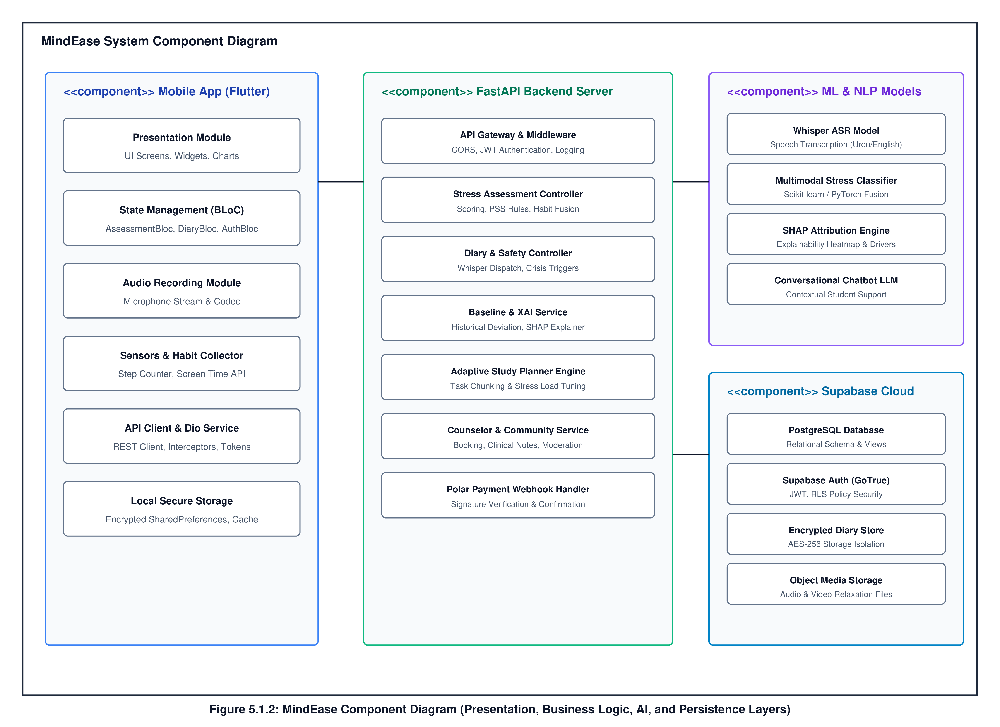

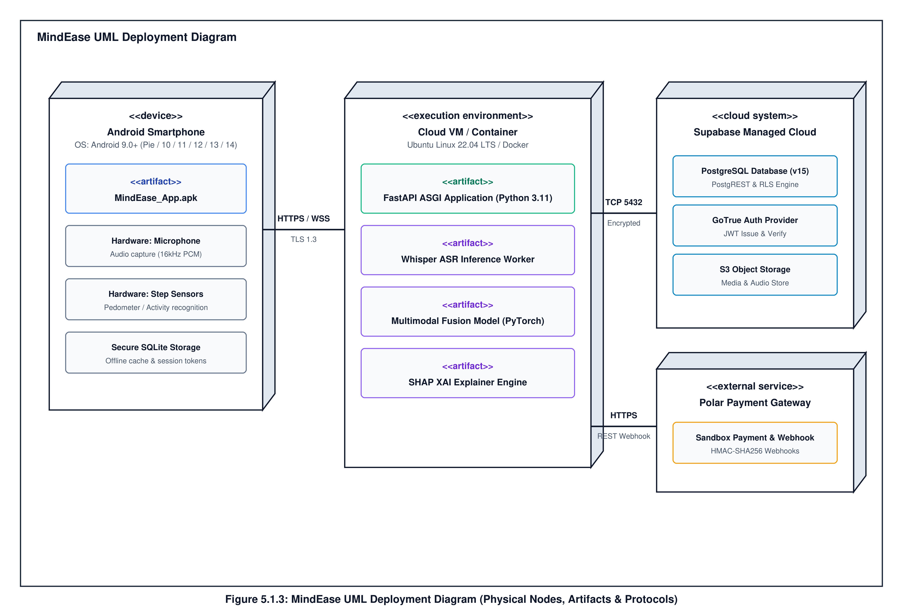

## 5.2 Logical Viewpoint

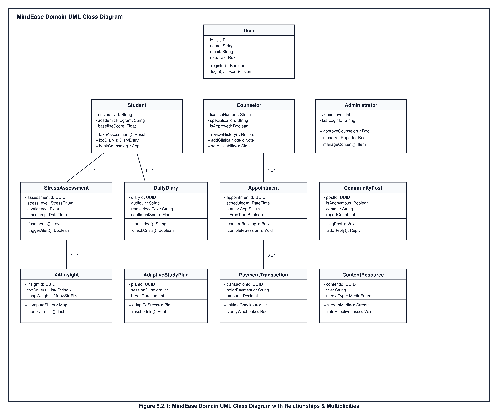

## 5.3 Information Viewpoint

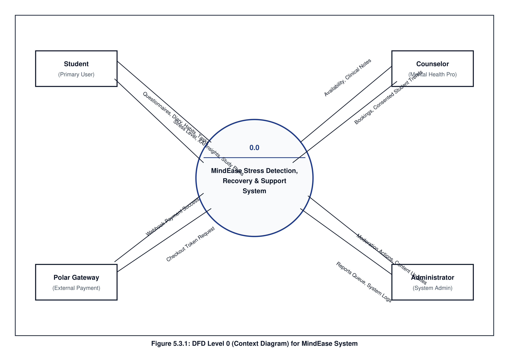

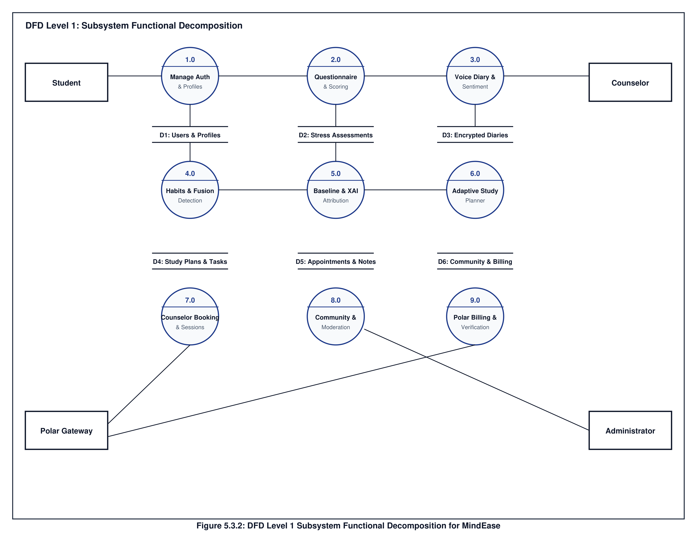

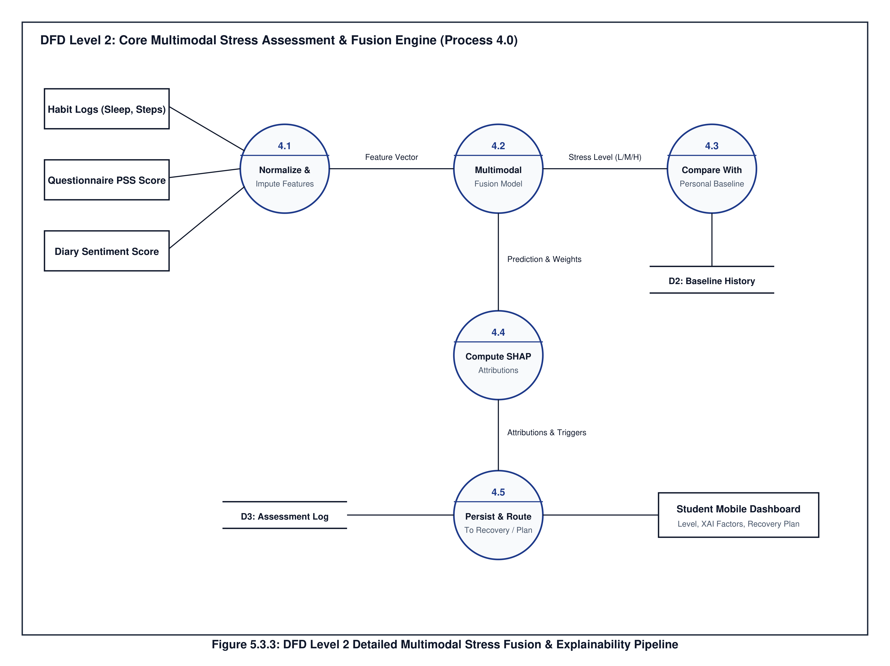

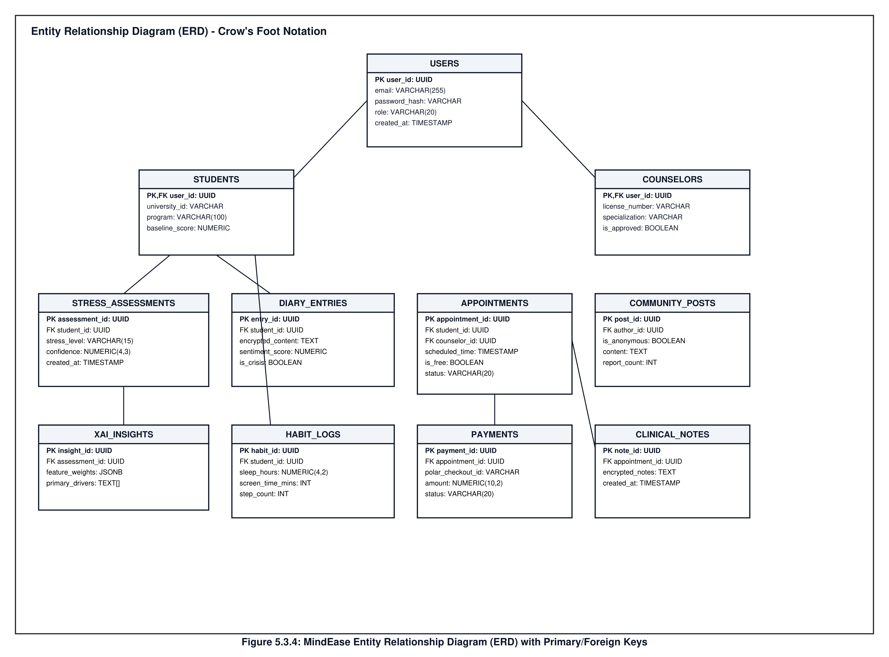

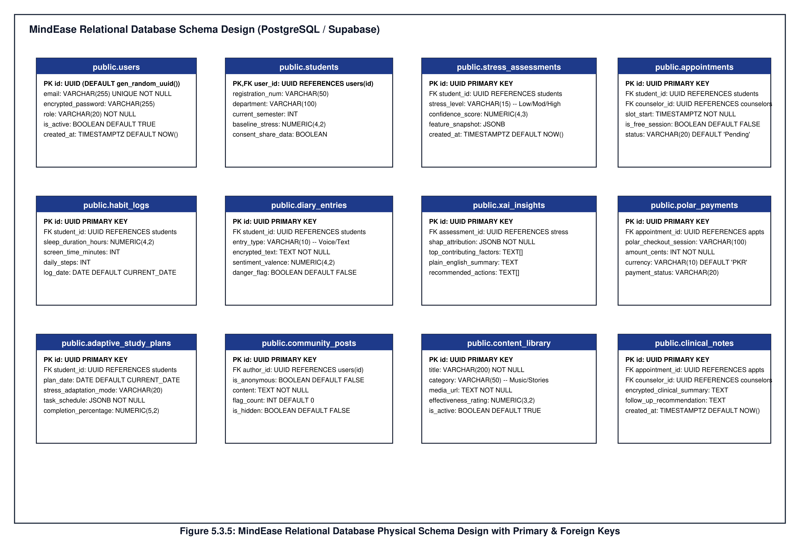

## 5.4 Interaction Viewpoint

### Table 5.4.1: Use Case to Sequence Diagram Traceability Matrix

| Use Case ID | Use Case Name | Sequence Diagram Figure | Verification Status |
|:---:|:---|:---:|:---:|
| **UC01** | Register & Create Profile | Figure 5.4.1 | Complete (100%) |
| **UC02** | Login & Multi-Role Authentication | Figure 5.4.2 | Complete (100%) |
| **UC03** | Complete Multilingual Stress Questionnaire | Figure 5.4.3 | Complete (100%) |
| **UC04** | Record Daily Voice and Text Diary | Figure 5.4.4 | Complete (100%) |
| **UC05** | Log Daily Habits & Calculate Stress Level | Figure 5.4.5 | Complete (100%) |
| **UC06** | View Stress Trends & Baseline Trigger Analysis | Figure 5.4.6 | Complete (100%) |
| **UC07** | View Explainable AI Stress Insights | Figure 5.4.7 | Complete (100%) |
| **UC08** | Access Relaxation Content & Rate Activity | Figure 5.4.8 | Complete (100%) |
| **UC09** | Chat with AI Conversational Assistant | Figure 5.4.9 | Complete (100%) |
| **UC10** | Generate & Manage Adaptive Study Plan | Figure 5.4.10 | Complete (100%) |
| **UC11** | Search Counselors & Request Appointment | Figure 5.4.11 | Complete (100%) |
| **UC12** | Conduct Counseling Session & Maintain Notes | Figure 5.4.12 | Complete (100%) |
| **UC13** | Process Appointment Payment via Polar | Figure 5.4.13 | Complete (100%) |
| **UC14** | Create & Interact with Peer Community Posts | Figure 5.4.14 | Complete (100%) |
| **UC15** | Report Inappropriate Community Post | Figure 5.4.15 | Complete (100%) |
| **UC16** | Manage System Users & Counselor Approvals | Figure 5.4.16 | Complete (100%) |
| **UC17** | Moderate Community Reports & System Content | Figure 5.4.17 | Complete (100%) |

### Figure 5.4.1: Sequence Diagram for UC01 - Register & Create Profile

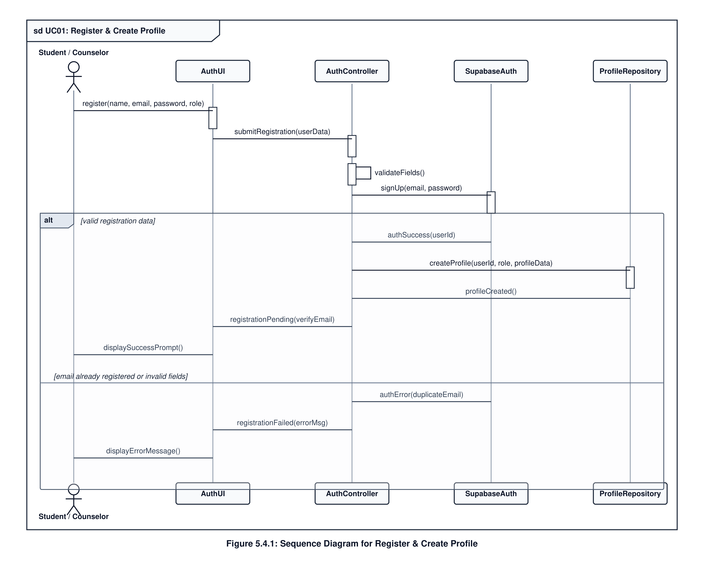

**Technical Workflow Narrative:** Illustrates the multi-role registration flow. The user submits details through AuthUI; AuthController validates input fields; SupabaseAuth creates authentication records; ProfileRepository stores role metadata; an alt fragment branches between successful pending registration and duplicate email error handling.

### Figure 5.4.2: Sequence Diagram for UC02 - Login & Multi-Role Authentication

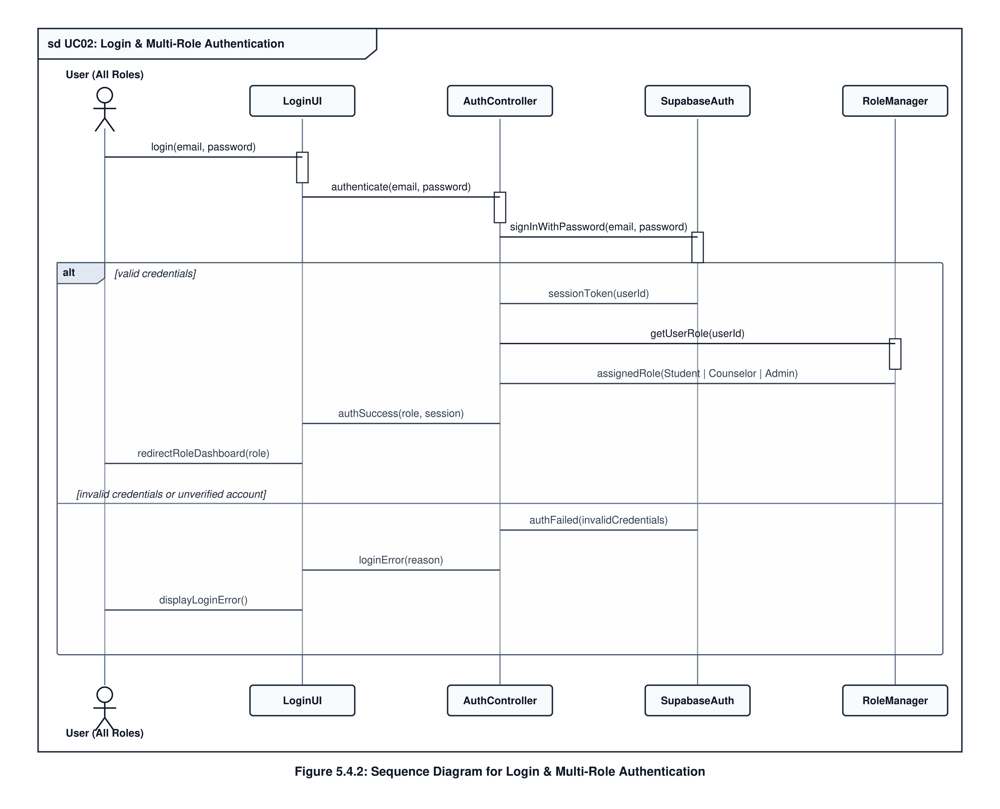

**Technical Workflow Narrative:** Depicts credential verification and multi-role routing. The user enters credentials; AuthController authenticates with SupabaseAuth; RoleManager inspects the assigned role (Student, Counselor, or Admin); an alt fragment handles successful session redirection vs invalid credential error display.

### Figure 5.4.3: Sequence Diagram for UC03 - Complete Multilingual Stress Questionnaire

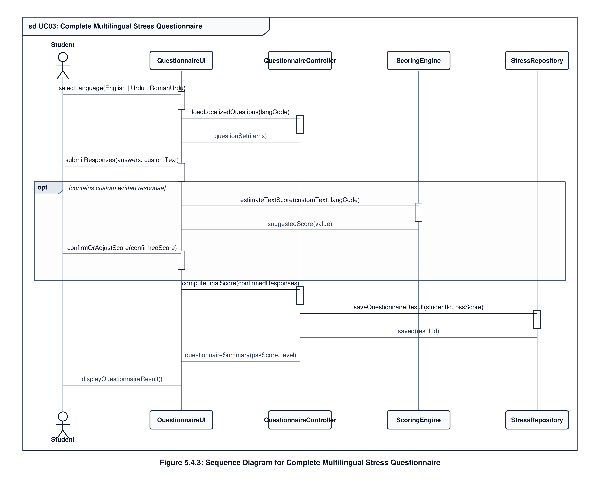

**Technical Workflow Narrative:** Demonstrates localized question loading in English, Urdu, or Roman Urdu. The student submits answers; an opt fragment invokes the AI Scoring Engine to suggest scores for custom written responses, allowing student confirmation before computing final PSS scores and saving records.

### Figure 5.4.4: Sequence Diagram for UC04 - Record Daily Voice and Text Diary

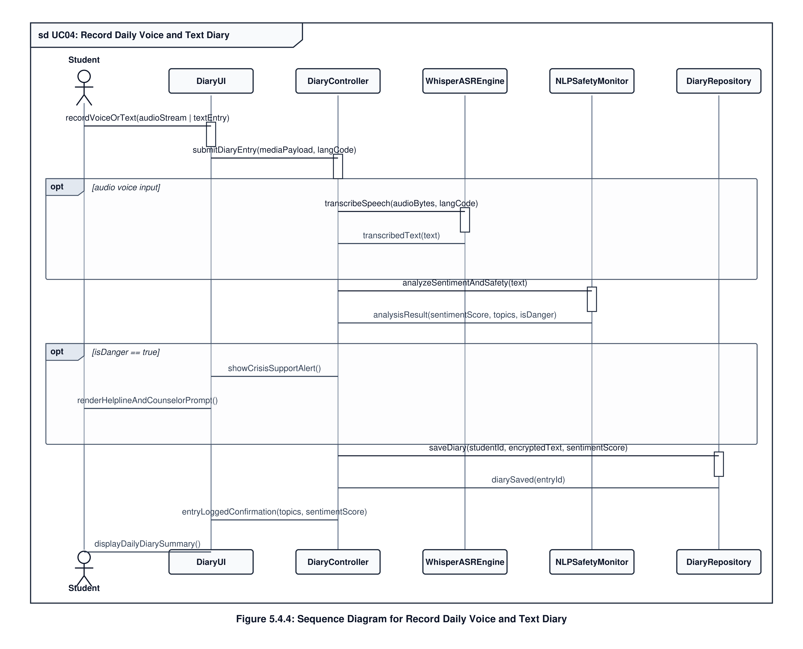

**Technical Workflow Narrative:** Details the audio recording and transcription workflow. Voice audio is processed by Whisper ASR; NLPSafetyMonitor extracts sentiments and checks for crisis indicators; an opt fragment activates emergency helpline overlays if danger is detected; clean entries are encrypted with AES-256 and persisted.

### Figure 5.4.5: Sequence Diagram for UC05 - Log Daily Habits & Calculate Stress Level

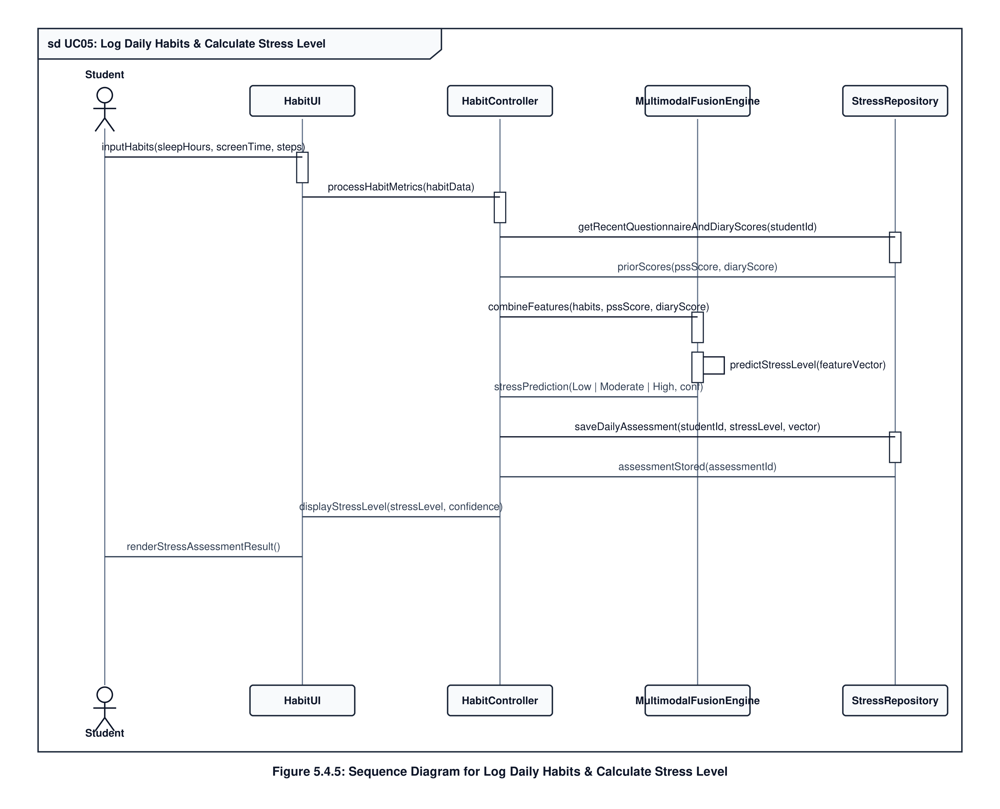

**Technical Workflow Narrative:** Models lifestyle metric logging (sleep, screen time, steps). HabitController gathers daily metrics, retrieves recent questionnaire and diary scores, and dispatches the combined feature vector to the Multimodal Fusion Model to classify stress as Low, Moderate, or High.

### Figure 5.4.6: Sequence Diagram for UC06 - View Stress Trends & Baseline Trigger Analysis

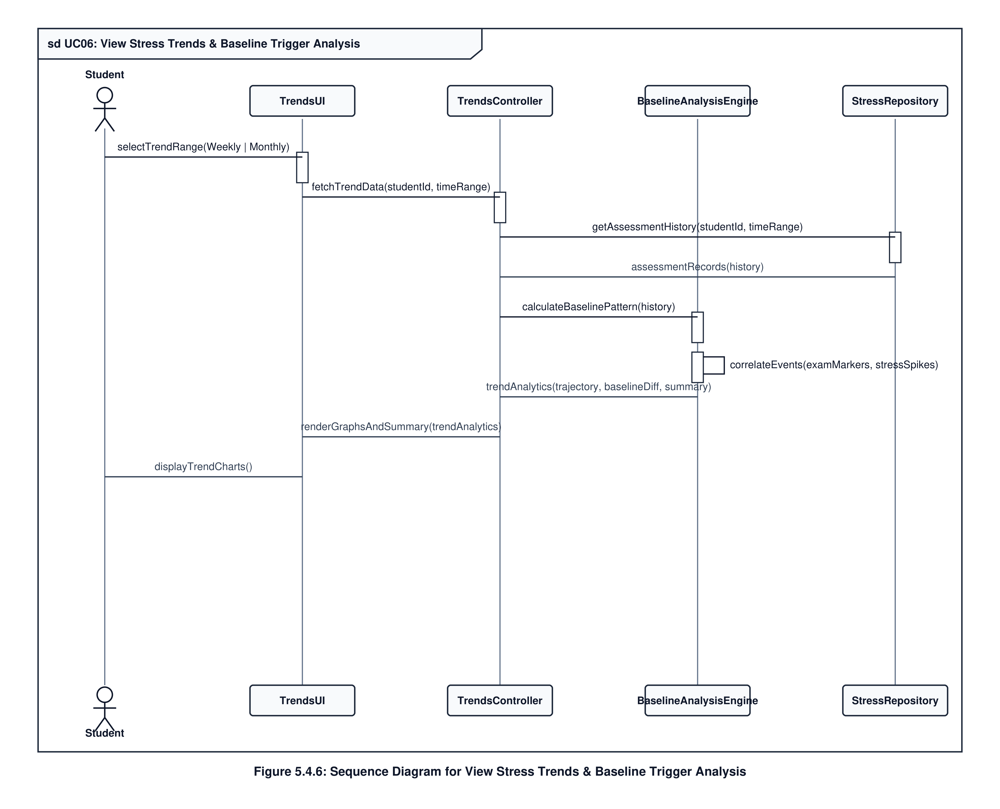

**Technical Workflow Narrative:** Shows retrieval of longitudinal assessments over weekly or monthly ranges. BaselineAnalysisEngine calculates rolling baselines, detects trend trajectories (improving, stable, escalating), and overlays university exam dates to highlight academic triggers.

### Figure 5.4.7: Sequence Diagram for UC07 - View Explainable AI Stress Insights

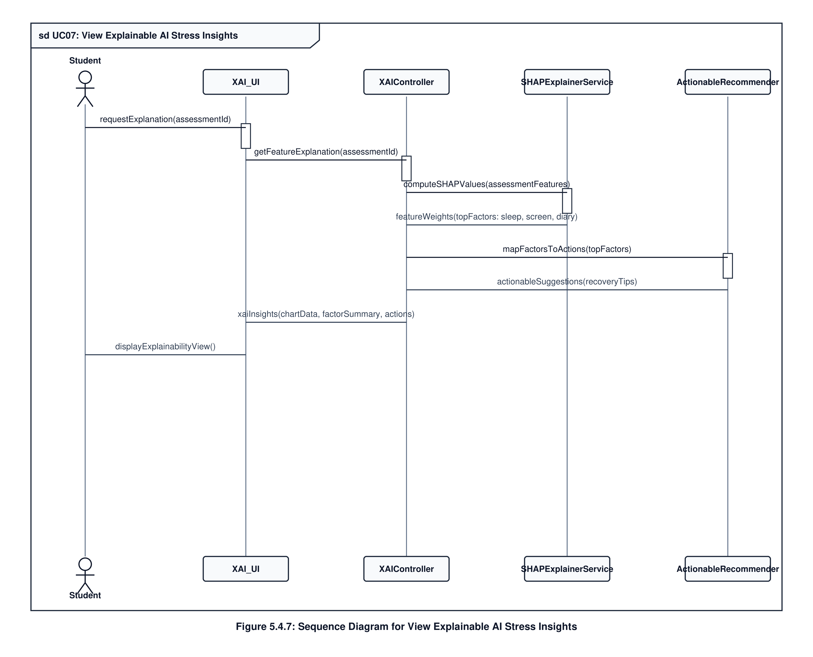

**Technical Workflow Narrative:** Illustrates Explainable AI generation. When the student clicks 'Why do I feel this way?', XAIController calls SHAPExplainerService to compute mathematical feature attributions, mapping top drivers (e.g., severe sleep deficit) to conversational insights and actionable recovery tips.

### Figure 5.4.8: Sequence Diagram for UC08 - Access Relaxation Content & Rate Activity

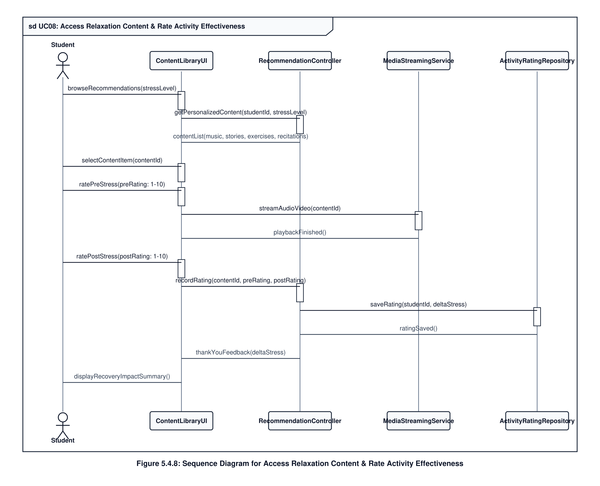

**Technical Workflow Narrative:** Traces personalized media recommendation and efficacy evaluation. The student selects relaxing media, rates pre-activity stress (1-10), streams content, and rates post-activity stress (1-10); the system records delta stress relief to optimize future suggestions.

### Figure 5.4.9: Sequence Diagram for UC09 - Chat with AI Conversational Assistant

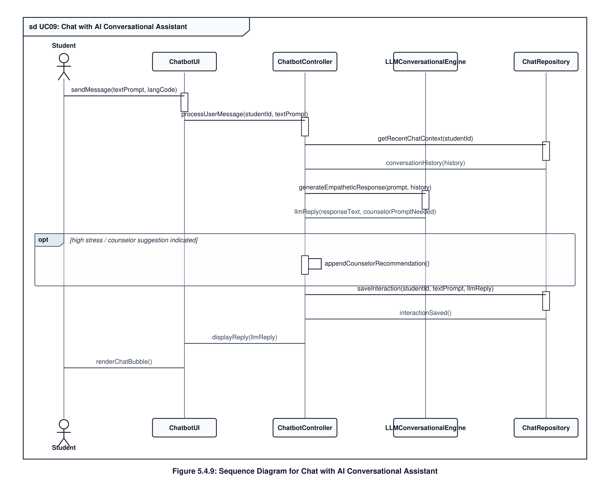

**Technical Workflow Narrative:** Captures conversational support. The student sends text or voice prompts; the controller retrieves chat history and consented stress context; the LLM engine returns supportive responses; an opt fragment suggests counselor booking if elevated anxiety is detected.

### Figure 5.4.10: Sequence Diagram for UC10 - Generate & Manage Adaptive Study Plan

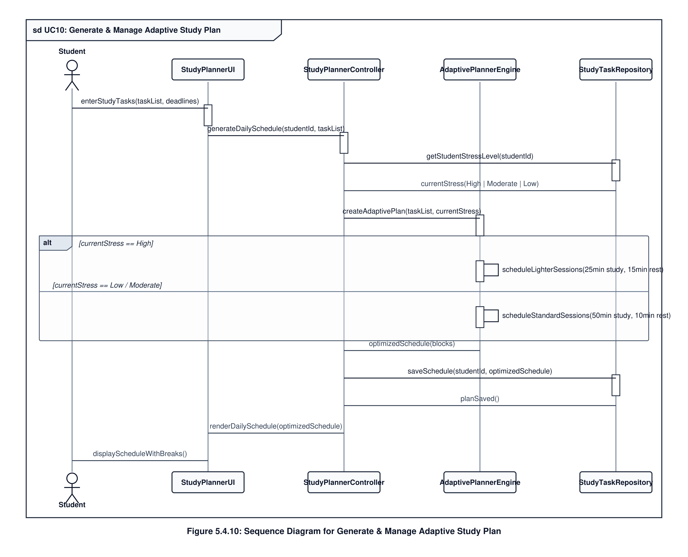

**Technical Workflow Narrative:** Depicts adaptive Pomodoro generation. The student inputs study tasks and deadlines; AdaptivePlannerEngine checks real-time stress; an alt fragment schedules lighter 25-minute blocks with calming breaks for High stress, or standard 50-minute blocks for Low/Moderate stress.

### Figure 5.4.11: Sequence Diagram for UC11 - Search Counselors & Request Appointment

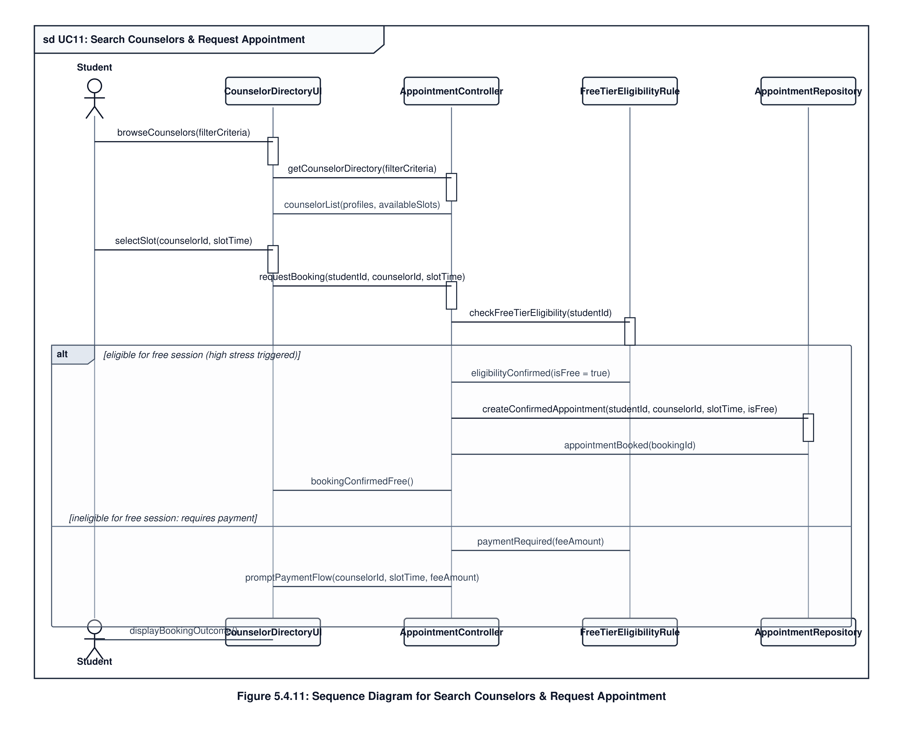

**Technical Workflow Narrative:** Models counselor directory filtering and slot selection. FreeTierEligibilityRule verifies whether the student qualifies for a free triage session following High stress; an alt fragment confirms free booking immediately or initiates the Polar payment checkout flow.

### Figure 5.4.12: Sequence Diagram for UC12 - Conduct Counseling Session & Maintain Notes

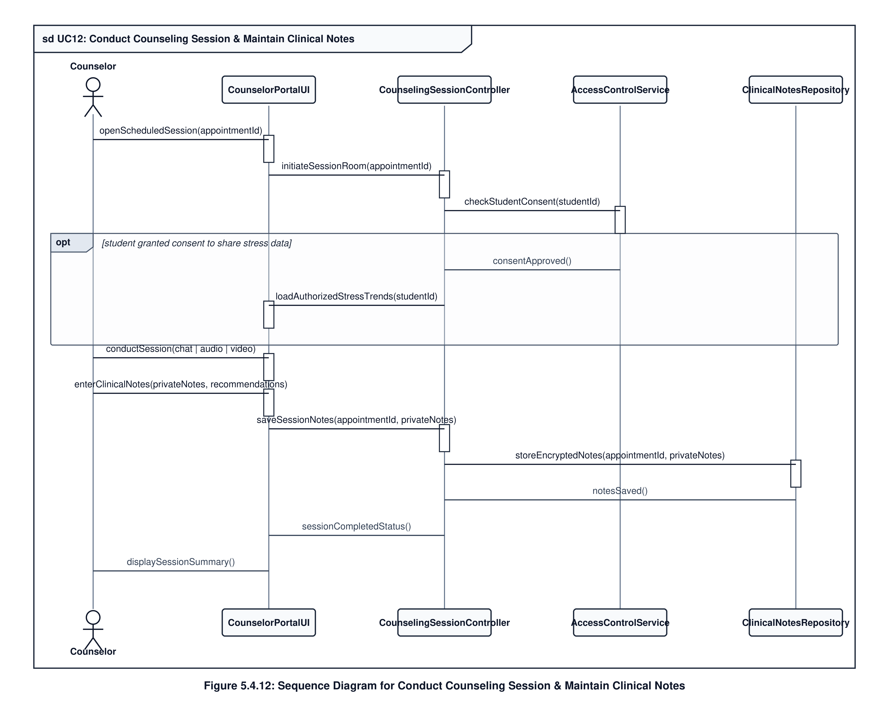

**Technical Workflow Narrative:** Illustrates session room management. AccessControlService checks student consent; if granted, the counselor reviews historical stress trends; following consultation, the counselor files encrypted clinical notes, archiving the appointment as Completed.

### Figure 5.4.13: Sequence Diagram for UC13 - Process Appointment Payment via Polar

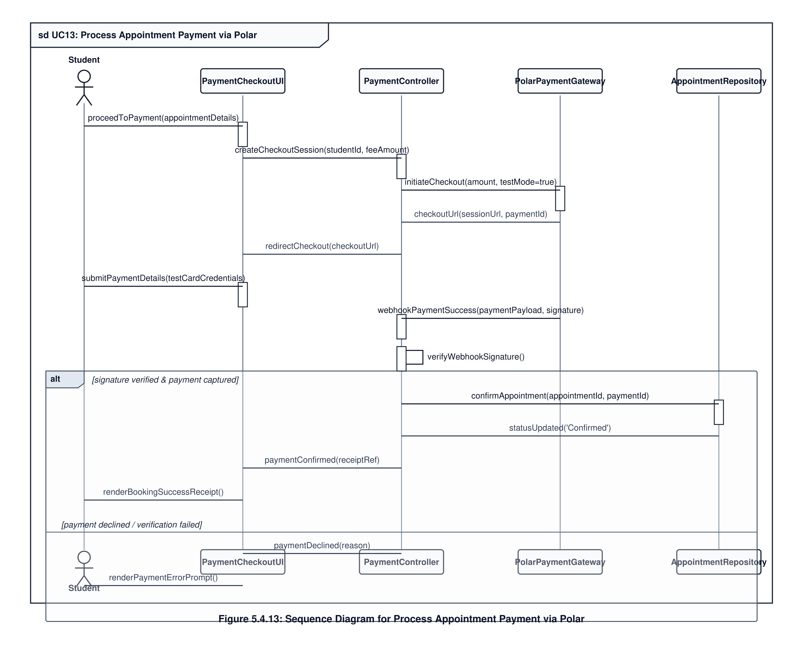

**Technical Workflow Narrative:** Details Polar sandbox payment processing. The student accesses the Polar checkout sheet; the backend ingests the asynchronous payment webhook, validates HMAC-SHA256 signatures, confirms the booking, and outputs a digital transaction receipt.

### Figure 5.4.14: Sequence Diagram for UC14 - Create & Interact with Peer Community Posts

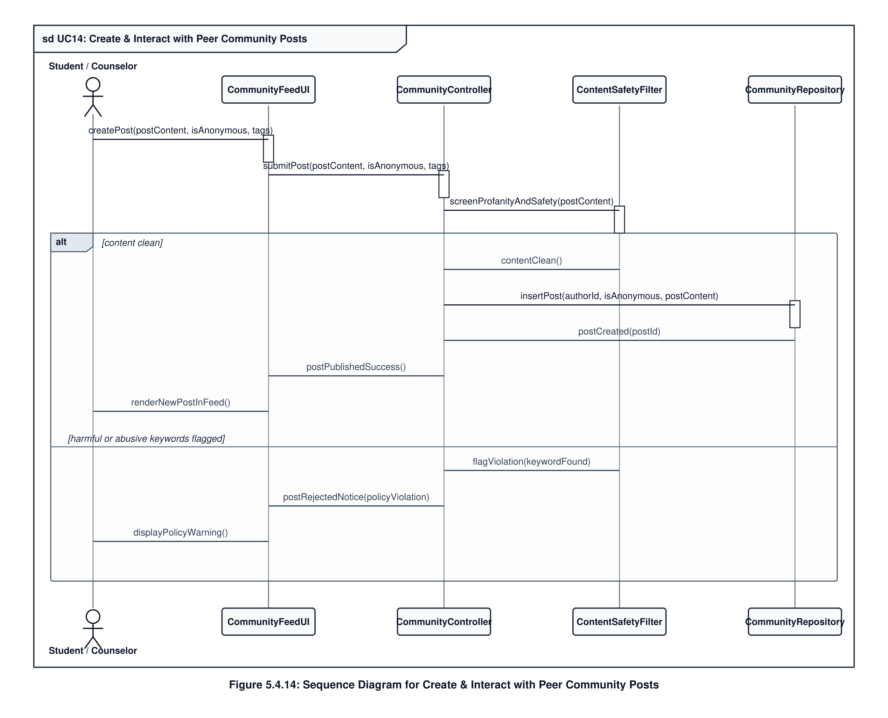

**Technical Workflow Narrative:** Traces peer message publication. ContentSafetyFilter screens text for toxicity; clean posts are published to the feed with optional anonymous pseudonyms; replies submitted by verified counselors automatically receive a distinct 'Counselor Badge'.

### Figure 5.4.15: Sequence Diagram for UC15 - Report Inappropriate Community Post

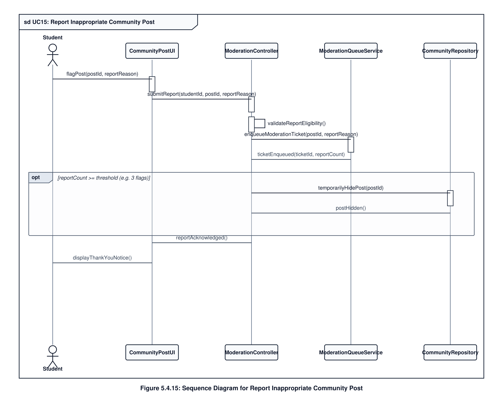

**Technical Workflow Narrative:** Shows post flagging and quarantine. The student submits a violation report; ModerationQueueService increments the flag counter; an opt fragment temporarily hides the post from public view if the flag threshold is reached, queuing it for admin review.

### Figure 5.4.16: Sequence Diagram for UC16 - Manage System Users & Counselor Approvals

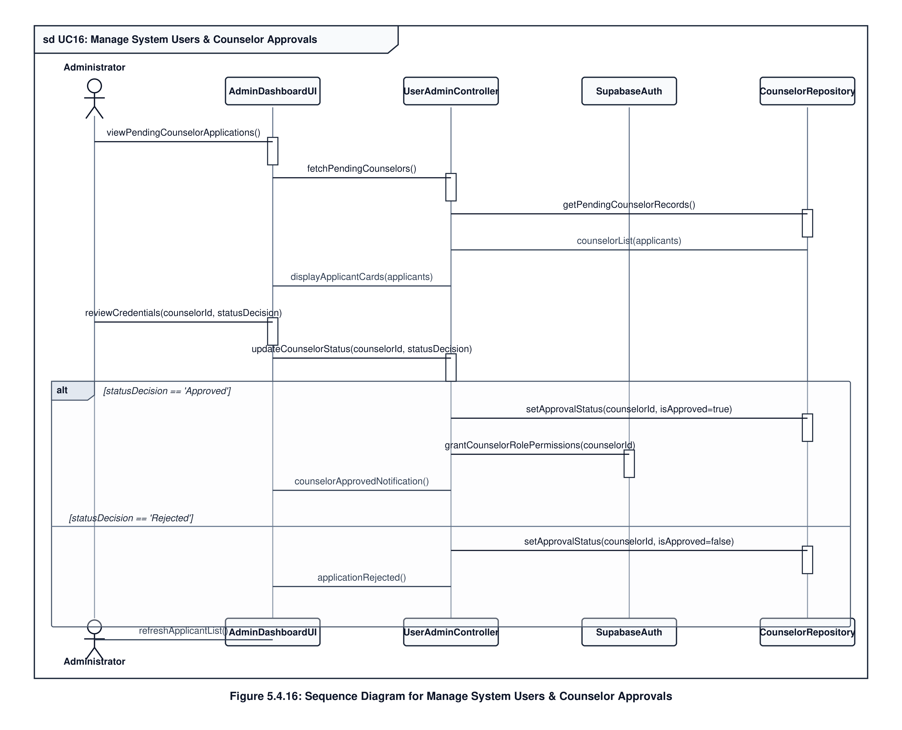

**Technical Workflow Narrative:** Models administrative user supervision. The admin inspects pending counselor credential uploads; an alt fragment branches between approval (granting counselor permissions and sending notifications) and rejection (recording feedback reasons).

### Figure 5.4.17: Sequence Diagram for UC17 - Moderate Community Reports & System Content

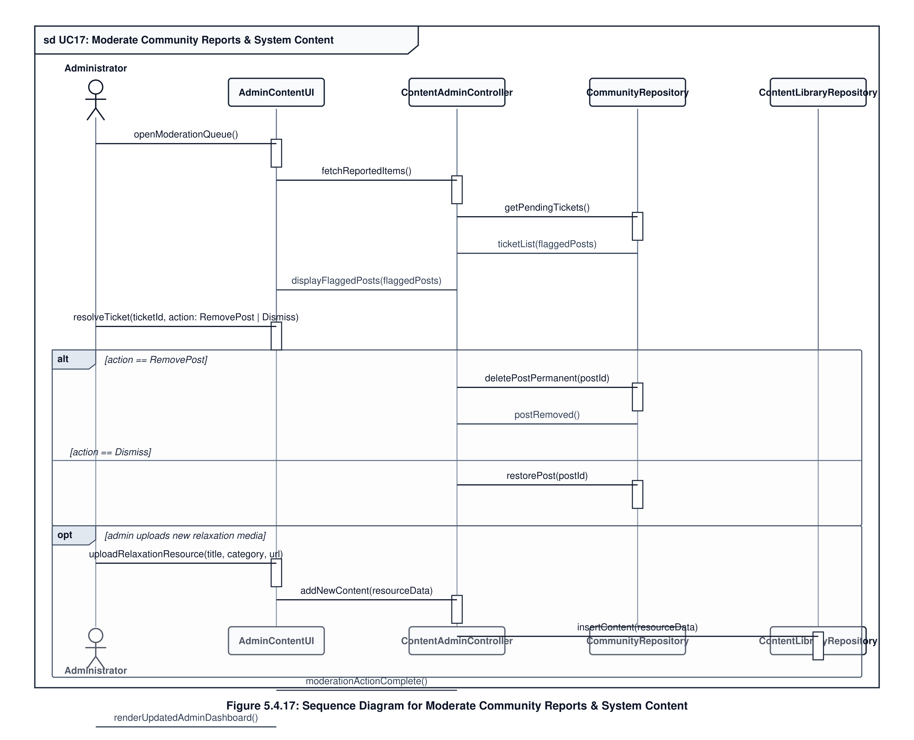

**Technical Workflow Narrative:** Depicts administrative moderation and content management. The admin resolves flagged community tickets (deleting abusive posts or dismissing false alarms) and curates relaxation audio/video resources in the public media catalog.

## 5.5 State Dynamics Viewpoint

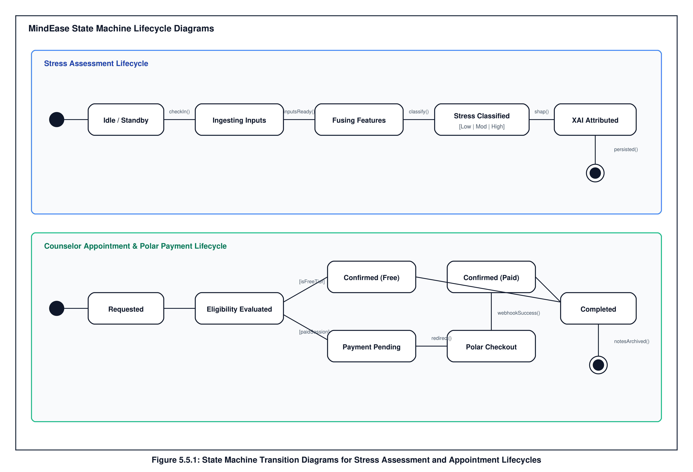

## 5.6 Algorithm Viewpoint

### Figure 5.6.1: Activity Diagram for Multimodal Stress Assessment & Fusion Workflow

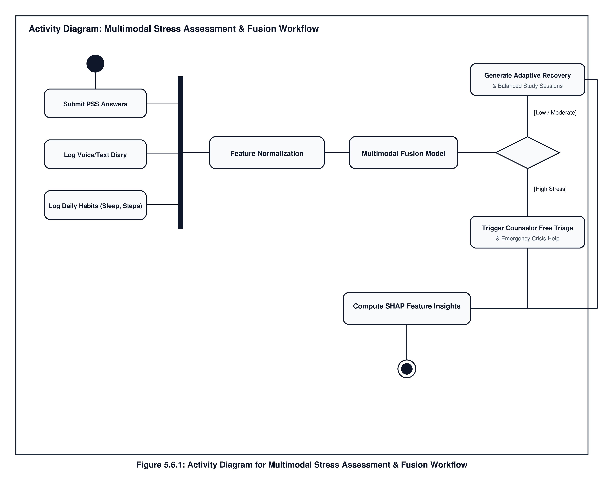

**Process Workflow Narrative:** Models the concurrent ingestion of PSS questionnaire answers, voice/text diary reflections, and habit metrics via a fork bar, followed by feature normalization, multimodal ML model fusion, stress level branching (Low/Moderate vs High), counselor triage escalation, and SHAP feature attribution calculation.

### Figure 5.6.2: Activity Diagram for Voice Diary Transcription, NLP Sentiment & Crisis Protocol

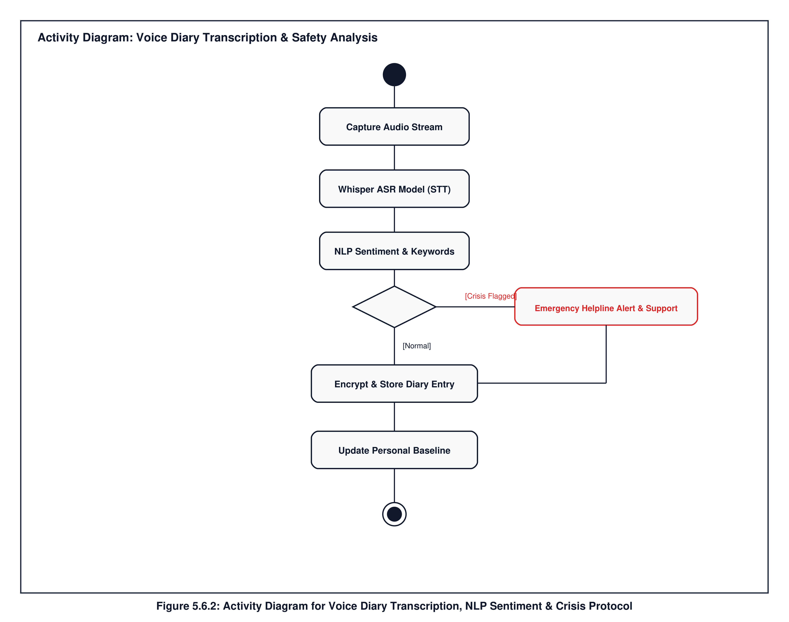

**Process Workflow Narrative:** Illustrates audio capture, Whisper ASR speech-to-text conversion, NLP sentiment extraction, and decision logic for crisis detection; if danger keywords are flagged, the emergency crisis helpline overlay is immediately presented before encrypting and persisting the diary entry.

### Figure 5.6.3: Activity Diagram for Adaptive Study and Recovery Planner

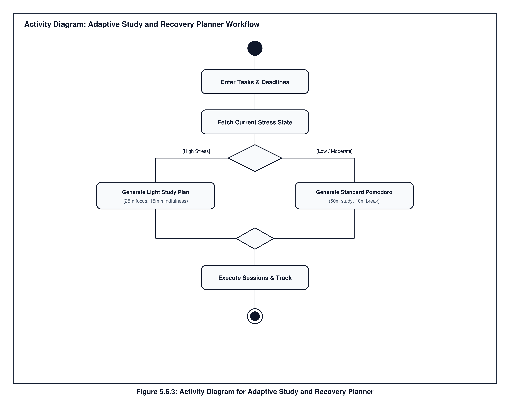

**Process Workflow Narrative:** Details task and deadline ingestion, real-time stress state evaluation, and branching into either a lightweight study schedule (25m focus with 15m mindfulness) or a standard Pomodoro schedule (50m study with 10m break), with end-of-day task roll-over capability.

### Figure 5.6.4: Activity Diagram for Counselor Booking & Polar Payment Verification

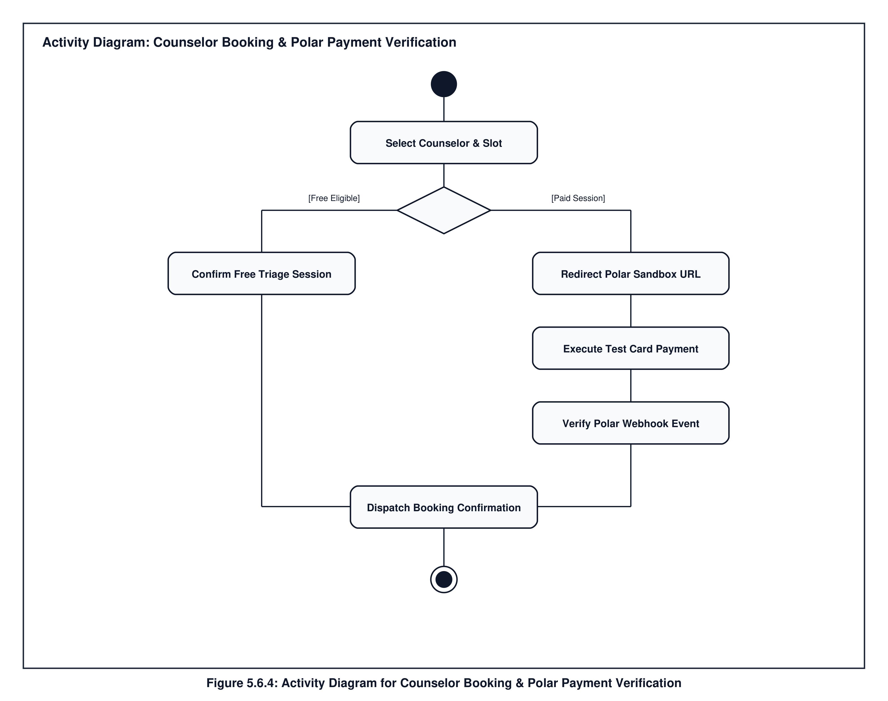

**Process Workflow Narrative:** Captures counselor slot selection, free-tier triage eligibility evaluation, redirection to the Polar sandbox payment sheet for paid sessions, asynchronous webhook signature verification, and final booking confirmation dispatch.

### Figure 5.6.5: Activity Diagram for Peer Community Post Creation & Moderation Workflow

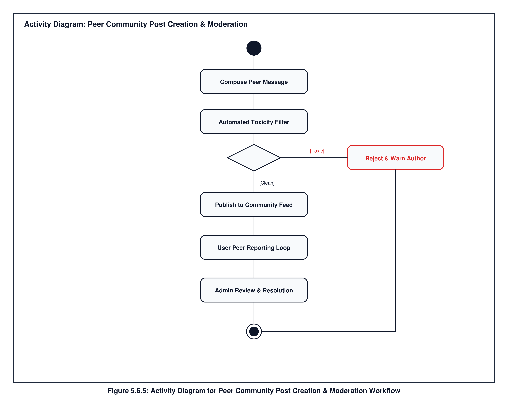

**Process Workflow Narrative:** Demonstrates post composition, automated toxicity screening (rejecting profane content), publication to the live community feed, peer report logging, and administrative review and queue resolution.

